# large_warehouse_world

ROS 2 package with a Gazebo simulation world of a large logistics facility: three warehouses, a reception and offices building and a truck loading zone, about 700 x 450 m. The world follows the plan of the facility, the zones are connected by doors of at least 3 m, every zone has its own iconography and the warehouses are filled with racks, shelves, pallets and handling equipment. It is ready to test robot fleets (ground robots, forklifts, drones) in intralogistics missions.

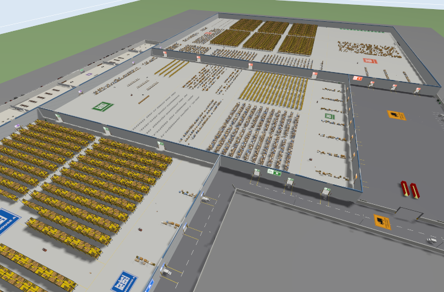
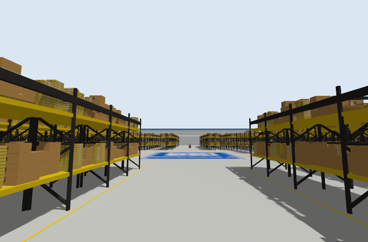
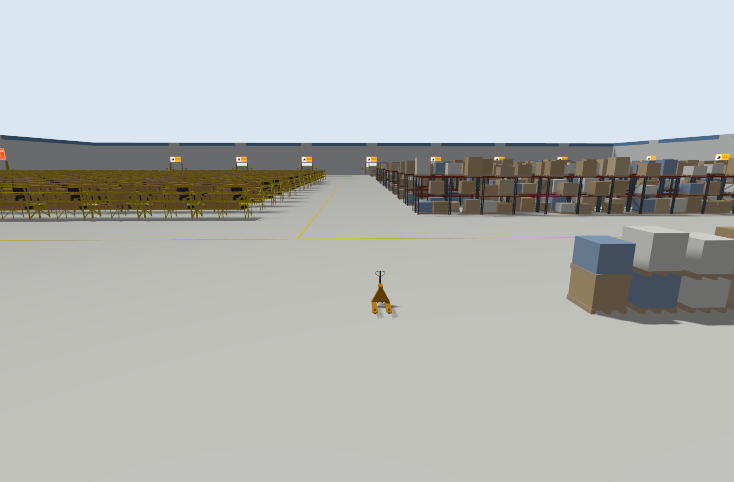

## Key Features

- **Plan of the facility**: Warehouse A (200 x 200 m), Warehouse B (200 x 300 m), Warehouse C (300 x 400 m), Recepción y oficinas (300 x 50 m) and Zona Carga Camiones (20 m wide truck lane and a 200 x 100 m truck yard).
- **42 openings**: doors between all the adjacent zones (6 m between warehouses, 4 m from the reception), 20 dock doors, 3 m doorways between offices and truck gates of 12 to 16 m.
- **Iconography**: every zone has its color and pictogram, on signs over every door (showing the zone at the other side), on the facades and painted on the floor (readable from above). Safety signs (forklifts, extinguishers, exit, speed limit) next to the doors.
- **Filled with what a warehouse has**: high bay racks, selective pallet racks, picking shelves, block stacked pallets, conveyors and packing tables, forklifts, pallet jacks, hand carts, a charging area, trucks at the docks, containers, offices furniture and a parking.
- **Ground truth**: zones and doors (`config/large_warehouse_world_zones.yaml`) and model poses (`config/large_warehouse_world_models.yaml`).
- **Lightweight for its size**: about 5 400 visuals and 800 collisions, real time factor 1 with almost 5x of physics headroom (see [Performance](#performance)).

## Requirements

- ROS 2 Jazzy
- Gazebo Harmonic (gz-sim 8) with `ros_gz_sim`
- Internet connection the first time the world is launched, to download the Fuel cars of the parking (`hatchback_blue`, `pickup`, `suv`). They are cached in `~/.gz/fuel` afterwards. All the other models are local.

## Installation

### Clone and Build

```bash
cd ~/ros2_ws/src
git clone https://github.com/juanscelyg/large_warehouse_world.git
cd ~/ros2_ws
colcon build --symlink-install --packages-select large_warehouse_world
source install/setup.bash
```

## Quick Start

```bash
ros2 launch large_warehouse_world large_warehouse_world.launch.py
```

Any world file of the package can be launched with the generic launch file:

```bash
ros2 launch large_warehouse_world large_warehouse.launch.py world:=large_warehouse_world.sdf
```

| Argument | Default | Description |
|---|---|---|
| `world` | `large_warehouse_world.sdf` | World file inside `worlds/` (only in `large_warehouse.launch.py`) |
| `gz_args` | `-r` | Extra arguments for `gz sim`, e.g. `-r -s` for headless |

The launch files add `share/large_warehouse_world/models` to `GZ_SIM_RESOURCE_PATH`. If you run `gz sim` directly, add that folder yourself so `model://` URIs are found.

> **Init poses:** suggested init poses for robots (free floor, x y in meters and z:=`0.5`):
> Warehouse A `100 300` (central plaza), Warehouse B `300 230`, Warehouse C `587 140`, reception `300 405`, truck lane `100 190`, truck yard `300 50`.

## Plan and zones

<!-- 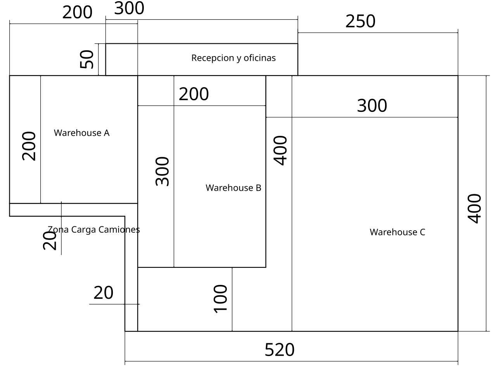 -->

The world frame has x to the east and y to the north. The origin is the south-west corner of the plan bounding box (x = 0 is the west wall of Warehouse A, y = 0 the south baseline of the plan). All the measures of the plan are in meters.

| Zone | Rectangle `[x_min, y_min, x_max, y_max]` | Walls | Contents |
|---|---|---|---|
| Warehouse A | `[0, 200, 200, 400]` | 12 m | High bay storage: 340 racks of 18 m (6.5 m high) in two fields with a 13 m main aisle, a central plaza, staging lanes in front of 7 docks |
| Warehouse B | `[200, 100, 400, 400]` | 12 m | Picking and expedition: 660 bays of selective pallet racks, 740 picking shelves, consolidation racks, block stacking lanes, packing area (3 conveyor lines, 48 tables), outbound pallets, staging in front of 10 docks |
| Warehouse C | `[400, 0, 700, 400]` | 12 m | Bulk storage and cross docking: 432 high bay racks, block stacking lanes, cross docking lanes in front of 3 docks, crates area, maintenance area with 13 charging stations, returns and quality control |
| Recepción y oficinas | `[150, 400, 450, 450]` | 6 m | Lockers and break room, two open offices, lobby with the reception counter and waiting areas, meeting area, management offices and archive |
| Zona Carga Camiones | `[0, 180, 200, 200]`, `[180, 0, 200, 180]`, `[200, 0, 400, 100]` | 3 m fence | L shaped 20 m truck lane and the truck yard: trucks at the docks, truck parking, containers, dumpsters, lamp posts, barriers and pallet stacks |

The area south of Warehouse B is not named in the plan; it is used as the truck yard of the loading zone. Zones and doors are written in [config/large_warehouse_world_zones.yaml](config/large_warehouse_world_zones.yaml):

```yaml
zones:
  warehouse_a:
    name: "Warehouse A"
    rects:
      - [0, 200, 200, 400]
doors:  # 42 openings
  - {type: dock, center: [15, 200], width: 4, height: 4.5, connects: [loading, warehouse_a]}
```

### Doors

| Connection | Openings | Width x height (m) |
|---|---|---|
| Warehouse A - Warehouse B | 3 doors (y = 255, 314, 375) | 6 x 5 |
| Warehouse B - Warehouse C | 4 doors (y = 140, 230, 314, 375) | 6 x 5 |
| Reception - Warehouse A / B / C | 1 / 2 / 1 doors | 4 x 3.5 |
| Loading zone - Warehouse A / B / C | 7 / 10 / 3 dock doors | 4 x 4.5 |
| Reception - outside | main entrance and staff entrance | 6 x 3.2, 3 x 3 |
| Offices (inside the reception) | 4 doorways | 3 x 2.6 |
| Loading zone - outside | 3 truck gates | 16, 16 and 14 |
| Truck lane - truck yard | 2 gates | 12 |

11 dock doors have a truck backed up to them, so they are blocked as in a real dock; the other 31 openings are free. An occupancy check (robot radius 0.4 m) reaches every zone from any other.

### Iconography

| | | |
|---|---|---|
| 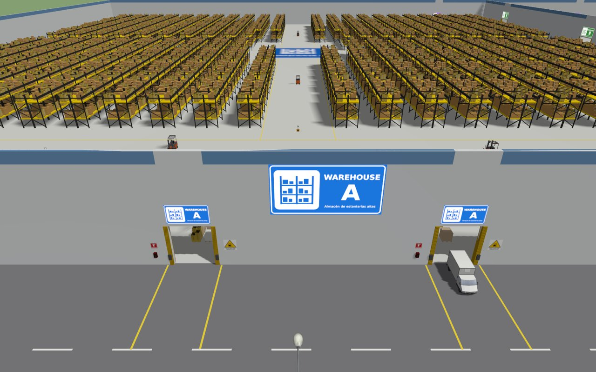 | 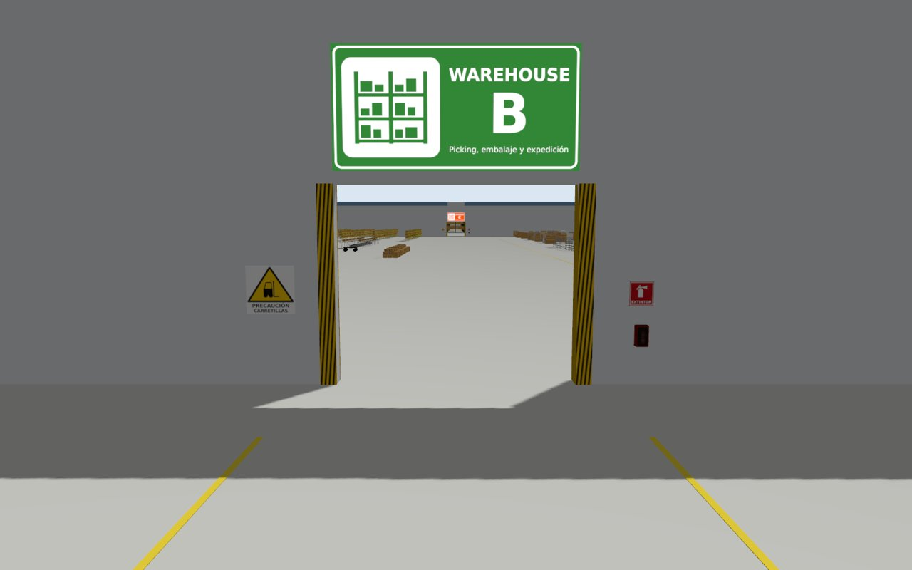 | 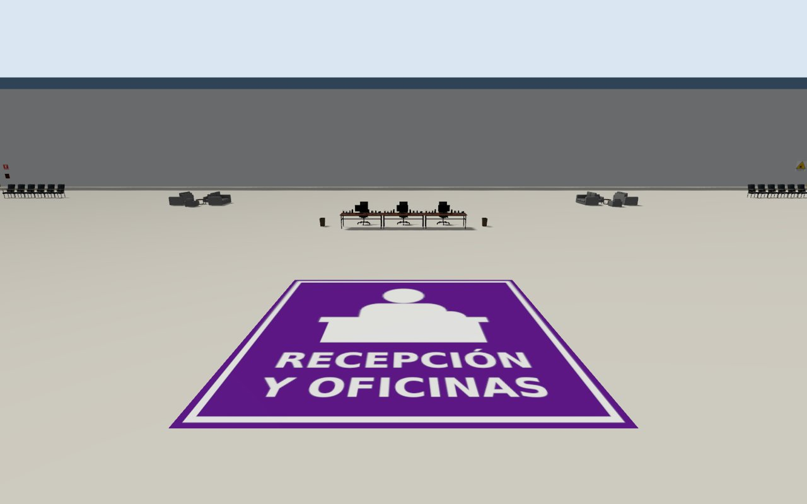 |
| Dock doors of Warehouse A: zone signs over the docks and on the facade, hazard stripes, bumpers, extinguishers and forklift warnings | Door from Warehouse A to Warehouse B: the sign shows the zone at the other side | Floor logo of the reception, readable from the main entrance |

- **Zone colors and pictograms**: Warehouse A blue, Warehouse B green, Warehouse C orange (pallet rack pictogram), reception purple (person at a counter), loading zone yellow (truck). The textures are in `models/large_warehouse_building/materials/textures` and are drawn by `scripts/generate_signs.py`.
- **Door signs**: over every opening, on both faces, showing the zone you enter; from inside, the exits to the outside show a `SALIDA / EXIT` sign. Signs use an emissive map so they are readable in shadow.
- **Floor logos**: 10 logos (7 to 20 m) painted on the floor of the zones, visible from above.
- **Facade signs**: on the outer walls of the warehouses and the reception.
- **Safety**: forklift warning and an extinguisher cabinet with its sign next to every warehouse door and dock, speed limit signs at the truck gates, exit signs over the reception doors.

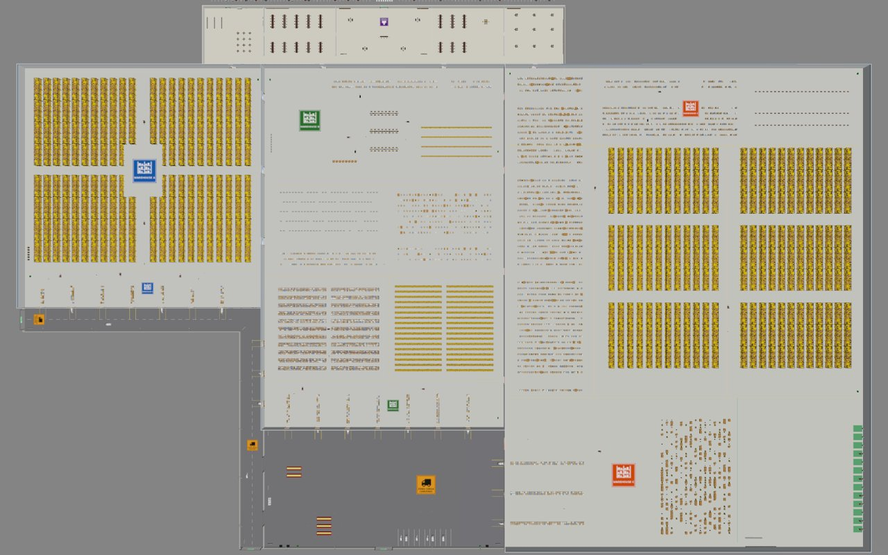

| | |
|---|---|
| 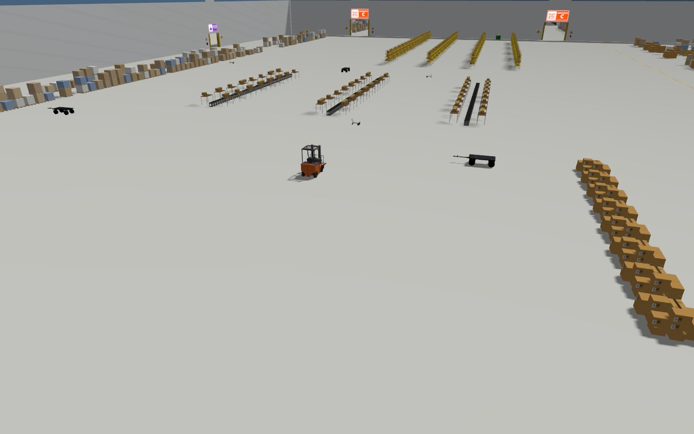 | 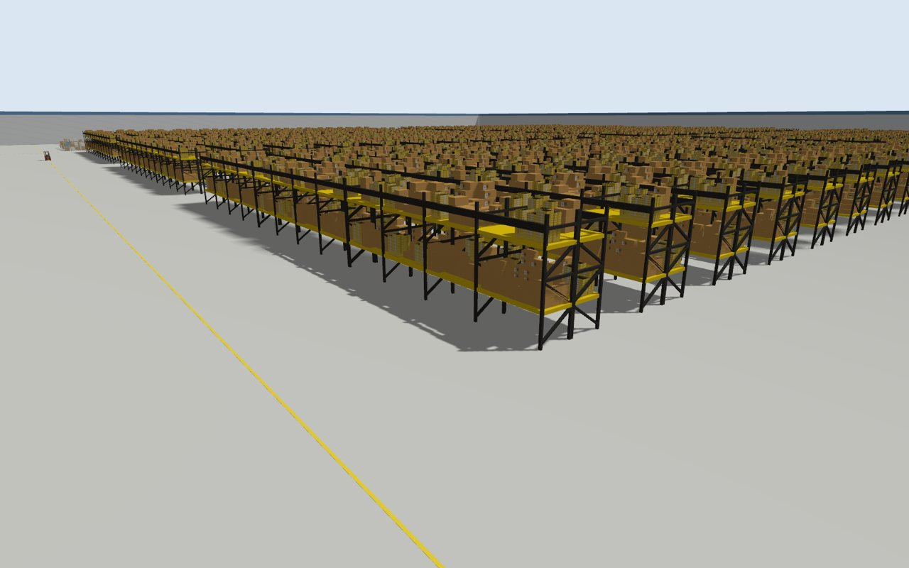 |
| 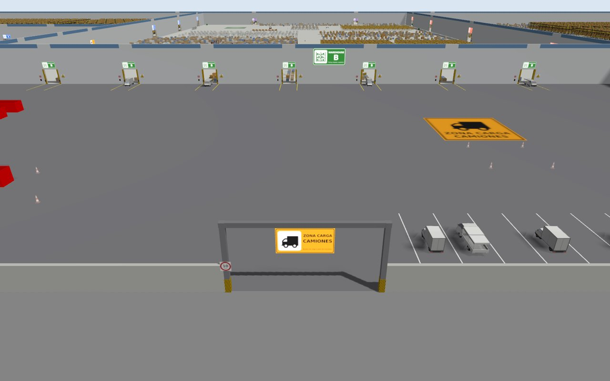 | |

## Generating the world

The world is generated by scripts from the plan, so it can be changed by editing the zone and door tables at the top of `scripts/generate_world.py` and running, from the package folder:

```bash
python3 scripts/generate_signs.py      # sign textures (needs Pillow, fonts-dejavu-core, fonts-font-awesome)
python3 scripts/generate_world.py      # grouped models, world file and zones yaml
python3 scripts/generate_models_yaml.py
```

`generate_world.py` writes:

| Output | Content |
|---|---|
| `models/large_warehouse_building` | Floors, walls, door openings and lintels, jambs, fences and gates, signs, floor logos, painted lines, parking and extinguisher cabinets |
| `models/warehouse_a_storage`, `warehouse_b_storage`, `warehouse_c_storage` | Racks, shelves and stored goods of each warehouse |
| `models/reception_furniture` | Furniture of the reception and offices |
| `models/loading_zone_props` | Lamp posts, jersey barriers, pallet stacks and cones |
| `worlds/large_warehouse_world.sdf` | The world: the grouped models plus the vehicles, handling equipment and bins as individual models |
| `config/large_warehouse_world_zones.yaml` | Zones and doors |

The grouped models are static and use world coordinates, so they are included at the origin; they keep the entity tree short. The vehicles and handling equipment (trucks, containers, forklifts, pallet jacks, hand carts, hand trucks, dumpsters, wheelie bins and cars) are individual models listed in `config/large_warehouse_world_models.yaml`. The random placement of goods uses a fixed seed, so the generation is reproducible.

## Performance

A facility of this size easily reaches tens of thousands of visuals and collisions. The generator keeps it light:

- **Batched meshes**: every plain color box (walls, lines, pallets and their loads) is merged into one OBJ mesh per color (`meshes/batch_*.obj` of each grouped model), so thousands of boxes are a few visuals.
- **Merged collisions**: the collisions of a row of racks, a pallet lane or a set of furniture are one bounding box.
- **No static contacts**: collision boxes start 1 cm above the floor, so the physics engine does not compute contacts between static models.
- **Bullet collision detector**: the world uses `<dart><collision_detector>bullet</collision_detector></dart>`, which scales much better than FCL with many static shapes. Remove it from the `<physics>` element to use the default detector (about 1.8x headroom instead of 4.8x).

Measured on an RTX 4070 laptop: the world loads in about 16 s, the physics runs at 4.8x real time without throttling, and a 1280 x 720 camera renders at about 24 fps.

## Models

All the models are in `models/` and can be used in any world:

```xml
<include>
  <uri>model://forklift</uri>
  <name>forklift_1</name>
  <pose>10 5 0 0 0 0</pose>
</include>
```

| Category | Models |
|---|---|
| Storage | `high_bay_rack`, `pallet_rack`, `picking_shelf_d`, `picking_shelf_e`, `storage_rack`, `box_pile_a`, `box_pile_c`, `box_pile_d`, `crate_stack`, `pallet_standard`, `euro_pallet`, `cardboard_box`, `large_crate`, `cargo_container_40ft` |
| Handling equipment | `forklift`, `pallet_jack`, `pallet_jack_yellow`, `hand_cart`, `handtruck`, `conveyor_block`, `charging_station` |
| Safety and services | `extinguisher_cabinet`, `fire_extinguisher`, `exit_sign`, `construction_cone`, `jersey_barrier`, `lamp_post`, `wheelie_bin`, `metal_cabinet`, `dumpster` |
| Vehicles | `truck_box`, `truck_delivery`, `hatchback`, `hatchback_red`, `hatchback_blue`, `pickup`, `suv` |
| Offices | `office_desk`, `office_chair_black`, `office_chair_grey`, `visitor_chair`, `chair`, `sofa`, `mini_sofa`, `coffee_table`, `cafe_table`, `table`, `bookshelf`, `white_cabinet`, `locker_big`, `vending_machine`, `fridge`, `kitchen_countertop`, `trash_bin` |
| Generated | `large_warehouse_building`, `warehouse_a_storage`, `warehouse_b_storage`, `warehouse_c_storage`, `reception_furniture`, `loading_zone_props` |

Model frames: trucks and cars have the cab at +x, the forklift has the forks at +y, desks and sofas face -x, office and visitor chairs face -y.

There are two kinds of models:

- **Local copies** of [Gazebo Fuel](https://app.gazebosim.org/fuel) models: made static, with relative URIs and without Ogre 1 material scripts. The vehicles and handling equipment also have simplified box collisions. `truck_box` and `dumpster` come from the `disaster_world` package; texture paths of `cardboard_box` and `cafe_table` were fixed.
- **Wrappers** that include the Fuel model (`hatchback_blue`, `pickup`, `suv`, from the `disaster_world` package). They are downloaded the first time they are used.

`charging_station` and the generated models are original work of this package.

## Package structure

```bash
large_warehouse_world/
├── config/      zones, doors and models ground truth
├── docs/        plan and images
├── launch/      launch files
├── models/      model library and generated models
├── scripts/     generators (signs, world, models yaml)
└── worlds/      world files
```

## License

The package is licensed under the Apache License 2.0. The models come from [Gazebo Fuel](https://app.gazebosim.org/fuel) (OpenRobotics, Open-RMF and jfrascon) and keep their own licenses, CC0 1.0 or CC BY 4.0. The license and the source of every local copy are in its `model.config`.
